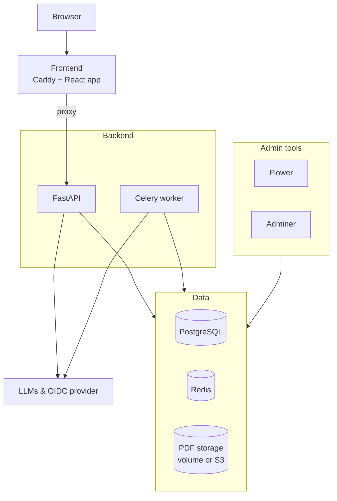

# Architecture

The diagram shows the production stack (`make start-prod`, [docker-compose.yml](../docker-compose.yml)). The development stack ([docker-compose-dev.yml](../docker-compose-dev.yml)) is the same except that the frontend is the Vite dev server, which proxies API requests to the backend, instead of Caddy serving a built bundle.

## Services

| Service | Role |
| --- | --- |
| Frontend | Caddy serves the built React app and reverse-proxies backend routes (`/api`, `/login`, `/logout`, `/register-and-privacy-policy`, `/terms-and-conditions`, `/openapi.json`, `/docs`). In development the Vite dev server does both jobs. |
| Backend | FastAPI application. Runs database migrations on startup when `RUN_MIGRATIONS=true`. |
| Celery | Runs the screening jobs in the background: LLM calls, and for PDF screening the text extraction and embeddings. |
| PostgreSQL | Main database, see [database.md](database.md). It must be the `pgvector` image, because a migration enables the `vector` extension. Embeddings are currently stored as JSONB, though. |
| Redis | Celery broker, and pub/sub channel that carries live progress events (published by the API and the workers) to the browser through the backend. |
| PDF storage | Uploaded PDFs. By default a Docker volume (`pdf_data`) mounted into the backend and Celery containers (`STORAGE_BACKEND=local`). With `STORAGE_BACKEND=s3` any S3-compatible service is used instead, configured with the `S3_*` variables. No S3 service is part of the compose stacks. |
| Flower | Celery monitoring UI. |
| Adminer | Database GUI. |

## LLMs and OIDC provider

- **LLMs:** the screening models are called through OpenRouter, OpenAI or a local OpenAI-compatible server, depending on what the user selects in the UI. TypeSafe Jev, a decision model that returns probabilities instead of text, is called through OpenRouter's System One API. See [local-models.md](local-models.md) for local models.
- **OIDC provider:** users log in through OpenID Connect. The issuer is set with `OIDC_ISSUER_URL` and defaults to the University of Helsinki login.

## Port mapping

All host ports are bound to `127.0.0.1` only. Containers are named with the environment as a suffix (for example `backend_dev`). The test stack (`make start-test`, [docker-compose-e2e.yml](../docker-compose-e2e.yml)) runs the production images with `APP_ENV=test` and publishes only the frontend. `make start-test-debug` instead runs the dev stack with test settings, on the dev stack's other ports.

| Service | Container port | Prod | Dev | Test |
| --- | --- | --- | --- | --- |
| Frontend (HTTPS) | 9443 (prod, test) / 3000 (dev) | 3000 | 3001 | 3002 |
| Frontend HTTP redirect to HTTPS | 9080 | 3080 | - | - |
| Backend API | 8080 | not published | 8090 | not published |
| Backend debugger | 5678 | 5678 | 5678 | not published |
| Celery debugger | 5679 | 5679 | 5679 | not published |
| Flower | 5555 | 5555 | 5556 | - |
| Adminer | 8080 | 8080 | 8081 | - |
| PostgreSQL | 5432 | 5432 | 5432 | not published |
| Redis | 6379 | 6379 | 6379 | not published |

The prod, dev and test columns are the defaults set by `make start-prod`, `make start-dev` and `make start-test` (the prod and dev frontend, Flower and Adminer ports can be overridden with `FRONTEND_PORT`, `FLOWER_PORT` and `ADMINER_PORT`). PostgreSQL, Redis and the debugger and backend ports are fixed in the prod and dev compose files, so only one of those stacks can run at a time. The test stack only needs port 3002 free.

Every service has CPU and memory limits (`deploy.resources.limits`) in the compose files, so a local stack doesn't take over the whole machine.

## Kubernetes / OpenShift

The staging and production deployments are not defined in this repository. Their Kubernetes/OpenShift manifests, together with the encrypted secrets and the deploy steps, live in a separate deployment repository. Look there to change resources, probes, the Redis image, routing or secrets.

This repository only provides the images. The deployments run the same `server` and `client` images that the [Dockerfile](../Dockerfile) builds. [build-staging.yml](../.github/workflows/build-staging.yml) and [build-prod.yml](../.github/workflows/build-prod.yml) push them to Quay as `backend-staging` / `backend-production`. The cluster re-imports those tags on a schedule, and a new digest restarts the backend, Celery and frontend pods, so merging and building is enough to roll out a new version.

When the app needs a new environment variable or secret, add it to the deployment repository as well as to the compose files here.
